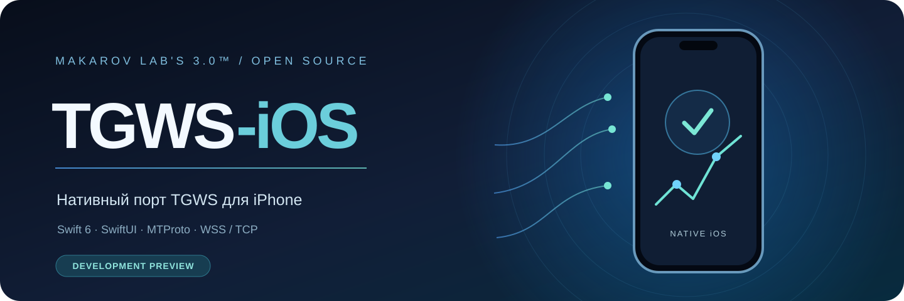
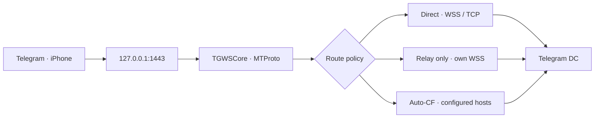
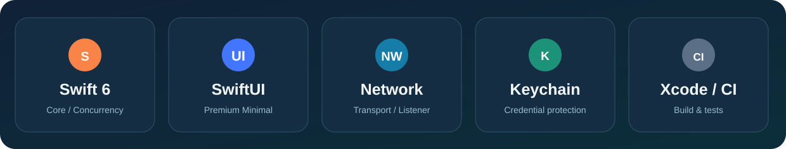

<p align="center">
  
</p>

<h1 align="center">TGWS-iOS</h1>
<p align="center">
  <strong>Нативный MTProto-прокси для Telegram на iPhone.</strong><br/>
  Независимый порт <a href="https://github.com/Kust3r3nk0/TGWS-Android">TGWS-Android</a> · Makarov Lab's 3.0™
</p>

<p align="center">
  
  
  
  
  
  
</p>

<p align="center">
  <a href="#о-проекте">О проекте</a> ·
  <a href="#дорожная-карта">Roadmap</a> ·
  <a href="#архитектура">Архитектура</a> ·
  <a href="#сборка">Сборка</a> ·
  <a href="#документация">Документация</a> ·
  <a href="README_EN.md">English</a>
</p>

> [!IMPORTANT]
> **Исследовательская версия, не готовый прокси.** В репозитории находятся Swift-пакет с моделями конфигурации, каркас iPhone-интерфейса, Keychain-хранилище и тесты базовых компонентов. **Рабочие MTProto-соединения, WSS/TCP-движок и надёжная фоновая работа пока не реализованы и не подтверждены.** Не публикуйте проект как готовое приложение и не используйте его как гарантированный способ подключения Telegram.

## О проекте

**TGWS-iOS** — отдельная iPhone-реализация логики [TGWS-Android](https://github.com/Kust3r3nk0/TGWS-Android), основанной на [Flowseal/tg-ws-proxy](https://github.com/Flowseal/tg-ws-proxy). Цель — локальный MTProto-прокси `127.0.0.1:1443`, который передаёт данные в Telegram через совместимый удалённый транспорт. Приложение **не позиционируется как системный VPN**.

Ключевая инженерная задача — проверить, может ли обычное приложение на iPhone обслуживать локальные подключения Telegram с приемлемым поведением при сворачивании, блокировке экрана и смене сети. До успешной проверки на физическом устройстве расширенная реализация остаётся условной.

### Планируемые возможности

| Направление | Цель | Текущий статус |
| :-- | :-- | :-- |
| iPhone UI | Три экрана: Главная, Диагностика, Настройки | Каркас написан; Xcode-сборка не подтверждена |
| Локальный MTProto | Obfuscated2, dd/ee, Fake TLS, DC / media | Не реализовано |
| Direct | Telegram WSS с TCP fallback | Не реализовано |
| Relay only | Только пользовательское WSS-реле, без direct-утечек | Не реализовано |
| Auto Cloudflare | Настроенные совместимые CF Proxy / Worker | Не реализовано |
| HTTP/2 media | Контролируемый h2 transport, если доступно | Отдельная экспериментальная стадия |
| Диагностика | Реальные сессии, ошибки и сетевые события | Только базовые модели |
| Безопасность | Keychain, TLS/hostname validation, ограниченный loopback | Keychain-код подготовлен; устройство не проверено |
| Обновления | Распространение через TestFlight / App Store | Не настроено |

## Дорожная карта

- [ ] **F0 — Feasibility gate.** Настоящий локальный listener, проверяемый MTProto handshake, тест с Telegram iOS и проверка фонового режима владельцем на iPhone.
- [ ] **F1 — Protocol Core.** AES-CTR, Obfuscated2, Fake TLS, packet framing и тесты совместимости с Android/Flowseal.
- [ ] **F2 — Transport Core.** Direct WSS/TCP, Relay-only, маршрутизация DC/media, таймауты и backoff.
- [ ] **F3 — Extended Transport.** Worker / CF Proxy, контролируемый Auto-CF, опциональный HTTP/2 media.
- [ ] **F4 — Product UI.** Premium Minimal, безопасные настройки, диагностика, RU/EN, accessibility.
- [ ] **F5 — Validation & Distribution.** CI, физические тесты, подпись, TestFlight и релиз только после решения владельца.

> [!WARNING]
> Apple может приостанавливать обычное приложение в фоне. **Foreground-прототип не доказывает возможность работы в фоне.** Не используйте фиктивный фоновый звук, VoIP, геолокацию или неразрешённые системные API. Системный Packet Tunnel — отдельная архитектура и требует отдельного согласования.

## Архитектура



*Это целевая архитектура, не схема уже работающего iOS-транспорта.* Локальные TLS и Fake TLS, удалённая проверка сертификатов и ограничения сессий должны соответствовать зафиксированному протокольному контракту Android-версии.

## Технологии

<p align="center"></p>

| Уровень | Стек |
| :-- | :-- |
| Язык и конкурентность | **Swift 6**, Swift Concurrency |
| Интерфейс | **SwiftUI**, iPhone-only, светлая / тёмная тема |
| Сеть | **Network.framework**, URLSession и системный TLS |
| Секреты | **Security.framework / Keychain** |
| Сборка | **Xcode**, **XcodeGen**, Swift Package Manager |
| Автотесты | **Swift Testing / XCTest**, GitHub Actions на macOS |
| Совместимость | Отдельные эталонные векторы Android и Flowseal |

## Сборка

Нужны **macOS**, актуальный совместимый Xcode, XcodeGen и Swift 6. Для установки на iPhone — подходящая подпись. Deployment target проекта: **iOS 17.0+**, device family: **iPhone**.

```bash
git clone https://github.com/Kust3r3nk0/TGWS-iOS.git
cd TGWS-iOS

# Unit tests for the portable module
cd Packages/TGWSCore && swift test && cd ../..

# Generate an Xcode project and build for Simulator
xcodegen generate --spec project.yml
xcodebuild -project TGWSiOS.xcodeproj \
  -scheme TGWSiOS \
  -sdk iphonesimulator \
  -destination 'generic/platform=iOS Simulator' \
  CODE_SIGNING_ALLOWED=NO build
```

> [!NOTE]
> Эти команды являются **инструкцией**, а не отчётом об успешной iOS-сборке. Первоначальные тесты модели Swift выполнялись в Linux-окружении; полноценные Xcode, симуляторные и физические проверки необходимо выполнить отдельно.

## Документация

| Документ | Назначение |
| :-- | :-- |
| [**Задание Codex**](CODEX_TASK.md) | Очередность этапов и условия реализации |
| [**Полное ТЗ (RU)**](docs/TECHNICAL_SPEC_RU.md) | Функции, архитектура, безопасность, критерии приёмки |
| [**Feasibility Gate F0**](docs/IOS_FEASIBILITY.md) | Проверка ограничений iPhone и Telegram |
| [**Матрица переноса**](docs/PORTING_MATRIX.md) | Соответствие Android ↔ Swift |
| [**Матрица тестирования**](docs/TEST_MATRIX.md) | Проверки Core / сети / iPhone |
| [**Правила для агентов**](AGENTS.md) | Границы изменений, качество кода, приватность |
| [**Брендинг**](docs/BRANDING.md) | Иллюстрации, логотип приложения и лицензирование |

## Разработка и безопасность

- Рабочие экспериментальные изменения — в `feature/*` и отдельных PR. Не объявлять релиз без проверки владельцем.
- Секрет, private Worker URL и другие учётные данные не помещать в коммиты, логи, crash-report или скриншоты.
- Никогда не отключать проверку TLS-сертификатов и имени хоста.
- Открывать listener только на `127.0.0.1`, а не на LAN / wildcard.
- `RELAY_ONLY` никогда не должен обращаться к direct Telegram endpoint.
- Не заявлять о проверке на iPhone, которую никто не проводил.

## Источники и лицензирование

Проект развивается независимо от Telegram, Apple и Flowseal. Оригинальная реализация — [Flowseal/tg-ws-proxy](https://github.com/Flowseal/tg-ws-proxy), Android-порт — [TGWS-Android](https://github.com/Kust3r3nk0/TGWS-Android). Лицензия — [MIT](LICENSE), сведения об авторстве — [NOTICE.md](NOTICE.md).

**Makarov Lab's 3.0™** · TGWS-iOS · open-source development.
